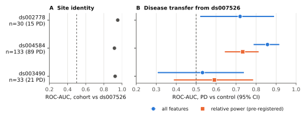
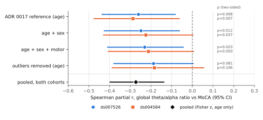

# Cross-site generalization of interpretable resting-state EEG markers of Parkinson's disease: a pre-registered multi-cohort study

**Kaleb Rodriguez**1

1 [affiliation: owner to complete]

*Submission draft (preprint), generated by `scripts/generate_manuscript.py` from the project's executed results at release v0.4.0. Research tool only; nothing here is a diagnostic or prognostic claim. Items marked [owner to complete] are listed in `docs/submission_checklist.md`.*

## Abstract

**Background.** Resting-state EEG features often separate people with Parkinson's disease (PD) from controls within one dataset. Whether they generalize across independent sites needs to be tested with an analysis fixed in advance.

**Methods.** We analysed 329 participants (231 PD) from four public OpenNeuro cohorts with one frozen pipeline (31 shared channels, interpretable region-level spectral and complexity features). A model trained on one cohort (ds007526) was evaluated once on each other cohort. Two new cohorts were tested under a pre-registered plan, and four further analyses were declared before their results: ComBat harmonization, a peak-separated aperiodic fit, leave-one-site-out training, and a within-PD clinical severity replication.

**Results.** Site was far more predictable than disease: classifiers identified the cohort of origin with ROC-AUC 0.92-0.95. Disease transfer was uneven: ds002778 0.72 [95% CI 0.52-0.89]; ds004584 0.86 [95% CI 0.79-0.92]; ds003490 0.53 [95% CI 0.31-0.74]. The pre-registered relative-power test passed on ds004584 (0.73 [95% CI 0.64-0.81]) but not on the smaller ds003490 (0.59 [95% CI 0.39-0.79]). Harmonization did not improve transfer consistently. Within PD, a global theta/alpha ratio was associated with lower cognitive scores (MoCA) at both sites with severity data (age-partialled Spearman r = -0.26 and -0.29, both p < 0.025), but this association did not pass pre-declared robustness checks: excluding extreme ratio values left r = -0.19 and -0.18 (p = 0.08 and 0.11).

**Conclusions.** Interpretable EEG features carry disease-related information that transfers to some independent sites but not reliably to all, and site effects dominate the feature space. A slowing index tracked cognition within PD at two sites, but the association is modest and concentrated in participants with marked slowing rather than graded across the range.

## 1. Introduction

In a systematic review of clinical correlates of quantitative EEG in Parkinson's disease (PD), cognition was the most-studied domain, and EEG slowing was associated with cognitive impairment in cross-sectional studies, while findings for motor function and treatment effects were inconsistent (Geraedts et al., 2018). Longitudinally, background rhythm frequency and relative theta power were examined as predictors of dementia onset in PD (Klassen et al., 2011).

Group differences or classifiers developed within a single EEG cohort can reflect site-specific acquisition, population and demographic structure rather than disease. Public, standardized EEG archives (Markiewicz et al., 2021; Pernet et al., 2019) now make it possible to test the same analysis on several independent cohorts. This study asks a narrower question: do interpretable resting-state features that separate PD from controls in one cohort still do so in independent cohorts, and where they do not, why? We emphasise pre-specified tests, participant-level uncertainty and reporting of negative results.

## 2. Methods

### 2.1 Cohorts

Four public CC0 datasets from OpenNeuro (Markiewicz et al., 2021), organized in EEG-BIDS (Pernet et al., 2019), were used (Katzir et al., 2026; Rockhill et al., 2021; Singh et al., 2023; Cavanagh, 2021). Counts are after quality control:

| cohort | role | n | PD / control | mean age | % male |
| --- | --- | --- | --- | --- | --- |
| ds007526 | development | 133 | 106 / 27 | 65.2 | 59% |
| ds002778 | external validation | 30 | 15 / 15 | 63.0 | 47% |
| ds004584 | confirmatory (pre-registered) | 133 | 89 / 44 | 69.3 | 64% |
| ds003490 | confirmatory (pre-registered) | 33 | 21 / 12 | 69.3 | 73% |

All recordings are eyes-open rest. For ds003490 only the eyes-open block of a longer recording was analysed.

### 2.2 Preprocessing and features

One pipeline, built on MNE-Python (Gramfort et al., 2013), was applied to all cohorts:

- the 31 shared 10-20 channels;
- per-cohort mains notch, 1-40 Hz band-pass, resampling to 250 Hz;
- average reference and 2 s epochs with amplitude-based rejection;
- recordings with fewer than 20 clean epochs were excluded.

Features were relative, absolute and log band power, slowing indices, complexity measures and an aperiodic (1/f) fit. They were averaged within five scalp regions and summarised per participant by the median and IQR over epochs (230 features).

Cohort-specific adapters restored an unstored reference channel and interpolated two channels absent in one cohort. Each adapter was decided from metadata before any results and is recorded in the decision log.

### 2.3 Evaluation

Models were the project's fixed baselines: regularized logistic regression, linear SVM, random forest, and an age/sex-only model. Within-cohort performance used participant-grouped repeated cross-validation. External evaluation fitted a model on all of ds007526 and evaluated it once on each other cohort, with nothing tuned on the external data. Intervals are 95% participant-level bootstrap CIs.

Pre-specified analyses, each fixed in a decision record before its result:

1. **Confirmatory transfer** of relative band power to two new cohorts.
2. **ComBat harmonization** (Johnson et al., 2007; Fortin et al., 2018).
3. **A peak-separated aperiodic fit** (Donoghue et al., 2020).
4. **Leave-one-site-out training.**
5. **A within-PD association** of two slowing markers with the Montreal Cognitive Assessment (MoCA; Nasreddine et al., 2005), controlling for age, followed by pre-declared robustness checks.

### 2.4 Pre-registration and reporting

Each pre-specified analysis was written as a decision record (ADRs 0013-0018 in the code repository) and committed before its result was computed. The repository history therefore shows the order of plan and result. Every number in this manuscript is filled in by a script from the committed result files, and a test fails if the text is out of date. Within-PD associations used Spearman partial correlation (variables and covariates rank-transformed, then the correlation of residuals after regressing out the covariate ranks), a two-sided t-test p-value and a participant-level percentile bootstrap CI (2000 resamples). The robustness criterion was fixed in advance: a negative association with p < 0.05 at both sites after adding sex, after adding sex and motor severity, and after excluding participants more than 3 robust SDs from their cohort's median ratio.

## 3. Results

### 3.1 Site dominates the feature space

Cohort of origin was predicted with ROC-AUC 0.95 (ds002778 vs ds007526), 0.92 (ds004584 vs ds007526), 0.92 (ds003490 vs ds007526). Within ds007526 the EEG model reached ROC-AUC 0.72 and age/sex alone 0.69.

### 3.2 Cross-site disease transfer

All-feature logistic regression trained on ds007526:

| external cohort | n (PD) | ROC-AUC |
| --- | --- | --- |
| ds002778 | 30 (15) | 0.72 [95% CI 0.52-0.89] |
| ds004584 | 133 (89) | 0.86 [95% CI 0.79-0.92] |
| ds003490 | 33 (21) | 0.53 [95% CI 0.31-0.74] |

Age/sex-only models were at or below chance on every external cohort.

In the pre-registered test, relative band power transferred to ds004584 (0.73 [95% CI 0.64-0.81]) but not detectably to ds003490 (0.59 [95% CI 0.39-0.79]). On ds004584 every feature family transferred to a similar degree. The earlier exploratory impression that only normalized features transfer therefore did not hold.

**Figure 1.** (A) ROC-AUC for telling each external cohort apart from the development cohort ds007526 (site identity). (B) ROC-AUC for PD versus control in each external cohort, from a model trained only on ds007526: all features (circles) and the pre-registered relative-power family (squares; tested on the two confirmatory cohorts). Bars are 95% participant-level bootstrap CIs; the dashed line is chance.

### 3.3 Harmonization and multi-site training

ComBat removed per-feature site differences, so cohort identity was no longer separable. It did not consistently improve disease transfer: the pre-declared criterion (better in all three cohorts) was not met for either variant, with or without age/sex protected.

Leave-one-site-out training (all-feature logistic regression):

| held-out site | trained on ds007526 only | 3 sites pooled | 3 sites, per-site z |
| --- | --- | --- | --- |
| ds007526 | - | 0.63 | 0.63 |
| ds002778 | 0.72 | 0.68 | 0.81 |
| ds004584 | 0.86 | 0.84 | 0.84 |
| ds003490 | 0.53 | 0.62 | 0.66 |

Multi-site training did not beat single-site training at every site, so the pre-declared hypothesis was not supported. Per-site standardization with multi-site training tended to help the two smallest sites; their intervals overlap.

### 3.4 Aperiodic activity

The PD-minus-control difference in the aperiodic exponent (Cohen's d) was smaller with the peak-separated fit than with a plain log-log fit:

- ds007526: 0.04 → -0.12
- ds002778: 0.52 → 0.38
- ds004584: 0.64 → 0.52
- ds003490: 0.41 → 0.07

The effect remained clearly non-zero only in ds004584 (0.52 [95% CI 0.18-0.89]). Part of the plain-fit effect therefore reflects oscillatory peaks.

### 3.5 Within-PD association with cognition

Among PD participants, the global theta/alpha ratio was associated with lower MoCA after controlling for age:

- ds007526: r = -0.26, p = 0.008, n = 103
- ds004584: r = -0.29, p = 0.007, n = 89

This met the pre-registered replication criterion. Pre-declared robustness checks were not passed. The sign stayed negative after adding sex and motor severity, but excluding extreme ratio values weakened it (r = -0.19, p = 0.08; r = -0.18, p = 0.11). The association is concentrated in participants with marked slowing and lower cognition, and is carried mainly by lower relative alpha. Occipital peak alpha frequency showed no association (r = 0.01 and 0.00).

**Figure 2.** Within-PD Spearman partial correlation between the global theta/alpha ratio and MoCA at the two sites with severity data, under the pre-registered analysis (age) and each pre-declared robustness check, with the fixed-effect pooled estimate. Bars are 95% bootstrap CIs; p-values are two-sided.

## 4. Discussion

Three conclusions follow:

- **Site effects dominate.** Disease-related transfer is real but uneven: clear for the largest independent cohort, absent for the smallest.
- **Harmonization does not fix this.** Per-feature harmonization, including ComBat, removed site offsets without fixing transfer. The limiting site differences are therefore not simple per-feature location and scale shifts. Training on several sites with per-site standardization is a promising direction, but it was not confirmed here.
- **A within-disease association replicates, modestly.** The theta/alpha ratio tracked cognition at two independent sites, even where PD-versus-control classification was site-dependent. It is driven by a tail of participants with marked slowing and did not pass the stricter robustness checks.

Of eight pre-registered or pre-declared tests, two passed. The robustness check of the within-PD association did not pass. We report all eight.

### Limitations

- External cohorts are small (n=30 and n=33), so intervals are wide.
- The development cohort is imbalanced (about 4:1 PD:control), with an age/sex confound.
- Quality-control exclusions were uneven across groups in two cohorts.
- One cohort provides only about 1 minute of eyes-open EEG per session.
- One cohort's motor scale is undocumented, so motor results are descriptive only.
- Two cohorts share an author.
- The ds002778 authors advise against PD-versus-control classification on their dataset because it has too few patients. Here it is one of three external test sets: no model was fitted or selected on it in the primary transfer analysis, its interval is wide, and no conclusion rests on it alone. It is one of the training sites in the leave-one-site-out analysis.
- Associations are observational.

## Data and code availability

Data are public on OpenNeuro under CC0:

- ds007526 (doi:10.18112/openneuro.ds007526.v1.0.2)
- ds002778 (doi:10.18112/openneuro.ds002778.v1.0.5)
- ds004584 (doi:10.18112/openneuro.ds004584.v1.0.0)
- ds003490 (doi:10.18112/openneuro.ds003490.v1.1.0)

The ds002778 authors ask to be contacted before publication and to be cited through their associated papers (Jackson et al., 2019; Swann et al., 2015; George et al., 2013; Appelhoff et al., 2019; Pernet et al., 2019). ds003490 is associated with Cavanagh et al. (2018). Code, decision records and executed results are at https://github.com/kalebrodriguez/NeuroPD (MIT licence; release v0.4.0).

## Declarations

- **Ethics.** This is a secondary analysis of publicly available, de-identified data released under CC0. No new data were collected and no participant was contacted. Approval and consent for the original data collection are described in each dataset's documentation. [owner to complete: any statement your institution or the preprint server requires]
- **Funding.** [owner to complete]
- **Competing interests.** [owner to complete]
- **Author contributions.** [owner to complete]
- **Use of AI tools.** The analysis code, decision records, figures and this draft were produced with an AI coding assistant (Claude Code) under the author's direction. Every number and figure is generated by executed code from the public data, and every reference was checked against a public record. [owner to confirm]
- **Not a medical device.** NeuroPD is a research tool and does not diagnose Parkinson's disease.

## References

- Appelhoff S, et al. (2019). MNE-BIDS: Organizing electrophysiological data into the BIDS format and facilitating their analysis. *Journal of Open Source Software* 4:1896. doi:10.21105/joss.01896
- Cavanagh JF, Kumar P, Mueller AA, Richardson SP, Mueen A (2018). Diminished EEG habituation to novel events effectively classifies Parkinson's patients. *Clinical Neurophysiology* 129:409-418. PMID 29294412
- Cavanagh JF (2021). EEG: 3-Stim Auditory Oddball and Rest in Parkinson's. OpenNeuro, dataset ds003490 v1.1.0. doi:10.18112/openneuro.ds003490.v1.1.0
- Donoghue T, et al. (2020). Parameterizing neural power spectra into periodic and aperiodic components. *Nature Neuroscience* 23:1655-1665. doi:10.1038/s41593-020-00744-x
- Fortin J-P, et al. (2018). Harmonization of cortical thickness measurements across scanners and sites. *NeuroImage* 167:104-120. doi:10.1016/j.neuroimage.2017.11.024
- George JS, Strunk J, Mak-McCully R, Houser M, Poizner H, Aron AR (2013). Dopaminergic therapy in Parkinson's disease decreases cortical beta band coherence in the resting state and increases cortical beta band power during executive control. *NeuroImage: Clinical* 3:261-270. doi:10.1016/j.nicl.2013.07.013
- Geraedts VJ, et al. (2018). Clinical correlates of quantitative EEG in Parkinson disease: a systematic review. *Neurology* 91:871-883. doi:10.1212/WNL.0000000000006473
- Gramfort A, et al. (2013). MEG and EEG data analysis with MNE-Python. *Frontiers in Neuroscience* 7:267. doi:10.3389/fnins.2013.00267
- Jackson N, Cole SR, Voytek B, Swann NC (2019). Characteristics of waveform shape in Parkinson's disease detected with scalp electroencephalography. *eNeuro* 6:ENEURO.0151-19.2019. doi:10.1523/ENEURO.0151-19.2019
- Johnson WE, Li C, Rabinovic A (2007). Adjusting batch effects in microarray expression data using empirical Bayes methods. *Biostatistics* 8:118-127. doi:10.1093/biostatistics/kxj037
- Katzir Z, Vered D, Maidan I (2026). PD-EEG: Resting-State & Walking EEG in Parkinson's Disease. OpenNeuro, dataset ds007526 v1.0.2. doi:10.18112/openneuro.ds007526.v1.0.2
- Klassen BT, et al. (2011). Quantitative EEG as a predictive biomarker for Parkinson disease dementia. *Neurology* 77:118-124. doi:10.1212/WNL.0b013e318224af8d
- Markiewicz CJ, et al. (2021). The OpenNeuro resource for sharing of neuroscience data. *eLife* 10:e71774. doi:10.7554/eLife.71774
- Nasreddine ZS, et al. (2005). The Montreal Cognitive Assessment, MoCA: a brief screening tool for mild cognitive impairment. *Journal of the American Geriatrics Society* 53:695-699. doi:10.1111/j.1532-5415.2005.53221.x
- Pernet CR, et al. (2019). EEG-BIDS, an extension to the brain imaging data structure for electroencephalography. *Scientific Data* 6:103. doi:10.1038/s41597-019-0104-8
- Rockhill AP, Jackson N, George J, Aron A, Swann NC (2021). UC San Diego Resting State EEG Data from Patients with Parkinson's Disease. OpenNeuro, dataset ds002778 v1.0.5. doi:10.18112/openneuro.ds002778.v1.0.5
- Swann NC, de Hemptinne C, Aron AR, Ostrem JL, Knight RT, Starr PA (2015). Elevated synchrony in Parkinson disease detected with electroencephalography. *Annals of Neurology* 78:742-750. doi:10.1002/ana.24507
- Singh A, Cole R, Espinoza A, Cavanagh J, Narayanan N (2023). Rest eyes open. OpenNeuro, dataset ds004584 v1.0.0. doi:10.18112/openneuro.ds004584.v1.0.0
